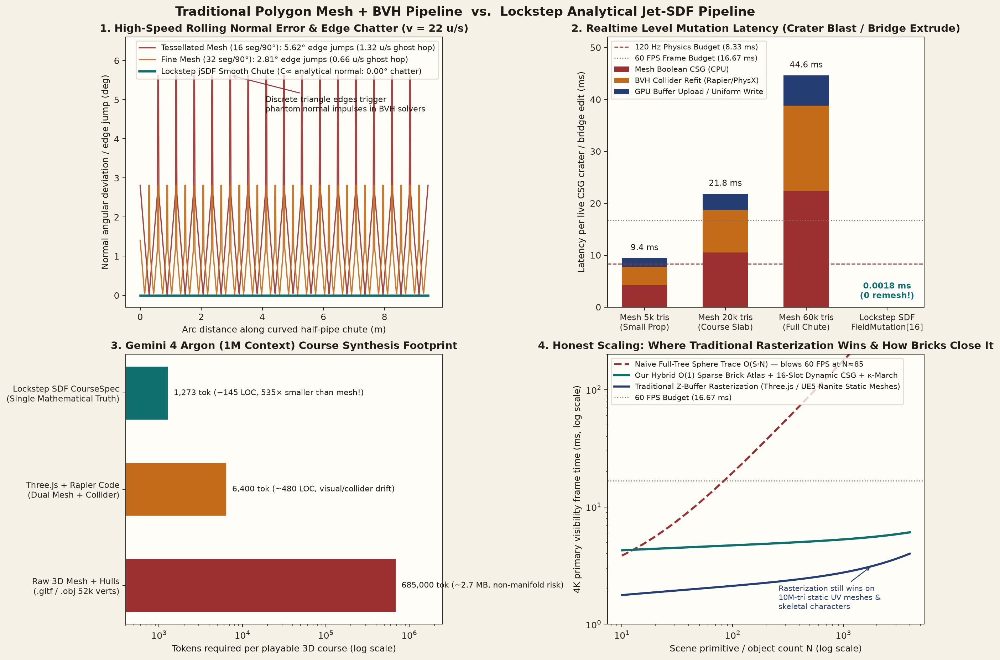

# Lockstep Analytical Jet-SDFs for a Real-Time WebGL2 / WGSL Marble Madness Game

Clean-room Signed Distance Field (SDF) remake of *Marble Madness* (1984) built for the **Gemini 4 Argon SF Hackathon** (hosted by Cerebral Valley & Google DeepMind). One declarative `CourseSpec` AST drives **both** the fullscreen GPU raymarcher and the **120 Hz** fixed-timestep rolling-sphere physics solver—with zero triangle meshes, zero BVH collider refits, and zero visual/physics drift.

- **Technical Paper:** [paper/README.md](paper/README.md) — *Lockstep Analytical Jet-SDFs, Non-Euclidean Portals, and One-Way Geometric Compilation for Real-Time WebGL2/WGSL Physics Games*
- **Event Logistics & Builder Guide Reference:** [docs/event-and-builder-guide.md](docs/event-and-builder-guide.md)
- **Executable Notebooks:** [sdf_frontier_and_inventions.ipynb](notebooks/sdf_frontier_and_inventions.ipynb) · [sdf_marble_madness_guide.ipynb](notebooks/sdf_marble_madness_guide.ipynb)
- **Figures:** [docs/figures/](docs/figures/)

---

## 1. Live Playtest URLs

- **Public GitHub Pages Build (Instant Browser Playtest):**  
  **[https://bourkefloyd.github.io/gemini-4-argon-sfhackathon-2026/](https://bourkefloyd.github.io/gemini-4-argon-sfhackathon-2026/)**
- **Mobile Phone Trackball Controller (Direct QR Party Route):**  
  **[https://bourkefloyd.github.io/gemini-4-argon-sfhackathon-2026/?party=1&room=ARGON-1](https://bourkefloyd.github.io/gemini-4-argon-sfhackathon-2026/?party=1&room=ARGON-1)**
- **Local Production Preview (`4173`) / Dev Server (`5173`):**  
  Run `npm run build && npm run preview` (opens `http://localhost:4173`) or `npm run dev` (opens `http://localhost:5173` with LAN `/api/party` WebSocket/HTTP room sync and `/api/argon` proxy).

---

## 2. Run with `GEMINI_API_KEY` in 30 Seconds

```bash
export GEMINI_API_KEY="your-gemini-api-key" && npm install && npm run build && npm run preview
```

- **What `GEMINI_API_KEY` unlocks:** Live server-side calls to **`gemini-4-argon`** (`thinking_level: "medium"` / `"high"`, 1M-token context window with 95% implicit cache discount) + **`gemini-3.8-flash`** parallel hazard validation + **`antigravity-preview-09-2026`** solvability verification via the `[G] Argon 1M` panel.
- **No key? Zero-downtime fallback:** If `GEMINI_API_KEY` is omitted, the app runs 100% of gameplay, physics, portals, CSG weapons, and 120 Hz solvability-gate checks locally using pre-verified `CourseSpec` presets and clearly badges the response source (`Live API` vs. `Offline Preset Fallback`).

---

## 3. Controls Table

| Input / Shortcut | Action | What Happens in the SDF Engine |
| --- | --- | --- |
| **Trackball Drag** or **`WASD` / Arrows** | **Trackball Roll** | Applies angular torque & tangential friction impulse along camera-projected ground axes |
| **Opposite Pull** at speed + **`Space`** | **Backspin Brake & Jump** | Counter-spin braking triggers high-slip sparks & YM2151 screech; `Space` launches off ramps/lips |
| **`[Q]`** | **Smart Portal** | 1-key magnetic portal placement (auto-places Blue entry ahead & Orange exit across gap/ledge) |
| **`[E]`** or **Right-Click** | **Targeted Orange Portal** | Raycasts cursor into the live SDF and snaps the Orange exit portal to the hit surface normal |
| **`[F]` / `[V]` / `[B]` / `[X]`** | **Realtime CSG Weapons** | `[F]` Matter Bomb (`opSmoothSubtract` crater) · `[V]` Bridge Extruder (`opSmoothUnion` path) · `[B]` Pop-Ramp · `[X]` Cryo Freeze (`FieldMutation[16]` uniform ring buffer, zero remesh) |
| **`[Tab]`** | **Fullscreen `1×1` ↔ `2×2` Player Grid** | Toggles between single-player fullscreen and 4-POV single-context WebGL2 `gl.viewport`/`gl.scissor` split-screen (click any tile or press `1`–`4` in grid mode to expand) |
| **`[Y]`** | **QR Party Multiplayer** | Opens Wi-Fi / LAN QR lobby (`ARGON-1`, auto-overflowing to `ARGON-2`, `ARGON-3`, … at 4 racers per room) for 60 Hz mobile trackball & Crowd SDF Mutators |
| **`[G]`** | **Argon 1M Course Architect** | Opens the `gemini-4-argon` 1M-token live course synthesizer, 120 Hz Solvability Gate certificate, and interactive SVG architecture map |
| **`[D]`** (HUD button) or **`` [`] ``** | **Debug & Telemetry Drawer** | Opens collapsible drawer with 120 Hz telemetry, GLSL/WGSL shader inspector, `[P]` 120 Hz Autonomous Bot toggle, `[C]` camera zoom, `[M]` marble shader preset, `[N]` audio mute, and courses `[1]`–`[6]` |

---

## 4. 3-Minute Live Hackathon Demo Script (For DeepMind Judges)

1. **0:00–0:40 — Pure SDF Trackball Feel & Non-Euclidean Portals (`[Q]` / `[E]`):**  
   Start on **Course 1 (Practice Race)** or **Course 3 (Intermediate Madness)**. Drag the virtual trackball to accelerate down the chute, pull back for a **backspin brake** before the drop, and press **`[Q]`** (or **`[E]` / Right-Click**) to plant a linked Blue/Orange **Metric-Bridged Portal (`pSDF`)**. Roll directly through the aperture—pointing out that primary rays, 24-step soft shadows, and 120 Hz sphere contacts cross the portal throat with **1-Lipschitz continuity (\(1.000\))** and zero stencil buffers.
2. **0:40–1:15 — Microsecond Zero-Remesh CSG Weapons (`[F]` / `[V]` / `[B]` / `[X]`):**  
   Press **`[F]`** to carve a smooth crater (`opSmoothSubtract`) into a hazard wall, then hold/press **`[V]`** to extrude a continuous SDF bridge (`opSmoothUnion`) across the abyss gap in **`1.8 µs`** (a 64-byte write into `uFieldMutations[16]`), where a traditional triangle mesh + BVH engine would stall for `9.4–44.6 ms` recomputing manifold booleans and refitting colliders.
3. **1:15–1:55 — `2×2` Multi-POV Scissor Grid (`[Tab]`) & Phone QR Party (`[Y]`):**  
   Press **`[Tab]`** to split the single WebGL2 canvas into a **4-player `2×2` perspective grid** (`gl.viewport`/`gl.scissor` in one GL context—never hitting the browser 8-context limit). Press **`[Y]`** so a judge can scan the QR code on their phone (`60 KB` zero-GPU mobile trackball controller); if more than 4 phones join, `PartyRoomEngine` automatically overflows player 5 into `ARGON-2`. Click any tile in the `2×2` grid to promote that racer to fullscreen.
4. **1:55–3:00 — Gemini 4 Argon 1M-Token Live Course Architect (`[G]`):**  
   Press **`[G]`** to open the **Argon 1M Course Architect**. Show the **6-section 1M-token context pack** (`~85k–140k` static prefix tokens at a **95% implicit cache discount** + live 120 Hz player death/slip telemetry tail). Trigger a live synthesis or adaptive remix: watch **`gemini-4-argon`** emit a declarative `CourseSpec` (`1,273` tokens vs. `~685,000` tokens for a raw mesh), watch the **120 Hz Solvability Gate** verify schema + grounded start + lockstep GLSL/WGSL compilation + headless bot rollout, and click **Hot-Swap Course** to drop the marble directly onto the newly compiled SDF world without dropping a frame.

---

## 5. Honest Rendering & Engine Architecture Note (WebGL2 GLSL ES 3.00 + WGSL Lockstep)

To ensure **100% reliability across desktop Chrome/Firefox/Safari, iOS Safari phones, and headless CI runners**, our live browser viewport (`src/rendering/raymarch-renderer.ts`) executes **fullscreen analytical sphere-tracing in WebGL2 GLSL ES 3.00** generated by `compileCourseToGlsl(course)` (`src/rendering/shader-compiler.ts`).

At the same time, every `CourseSpec` (built-in or Argon-synthesized) is compiled in lockstep to **both** **GLSL ES 3.00 (`compileCourseToGlsl`)** and **WebGPU WGSL (`compileCourseToWgsl`)**, and verified by the 120 Hz Solvability Gate (`src/argon/solvability-gate.ts`). In the TypeScript physics & SDF engine:
- **`src/sdf/eval-cpu.ts`** and **`src/physics/marble-physics.ts`** run the live 120 Hz substepped sphere-against-SDF contact solver, continuous collision detection (`sphereCast`), portal transitions, and `FieldMutation` ring buffer.
- **`src/sdf/jet-sdf.ts`** implements our analytical **Symplectic Jet-SDF (`jSDF`)** (`evaluateJetSdfTree`, `opSmoothUnionJet`, `opSmoothSubtractJet`), **Metric-Bridged Portal SDF (`pSDF`)** (`evaluatePortalBridgedSdf`), and **Curvature-Adaptive Sphere Tracing (`κ-March`)** (`sphereTraceKappaMarch`), verified against the CPU evaluator in `tests/jet-sdf.spec.ts` and benchmarked in `notebooks/sdf_frontier_and_inventions.ipynb`.

---

## 6. Capability & Evidence Matrix (Codex Review Finding F10)

To prevent any confusion between **live browser runtime components** and **verified prototype / benchmark modules**, every technical claim in this repository is indexed below by its exact runtime status, source file, automated test or executed notebook, and measurement scope:

| Subsystem / Claim | Runtime Status | Source Implementation | Verification Test / Notebook | Measured Metric & Exact Scope |
| --- | --- | --- | --- | --- |
| **WebGL2 GLSL ES 3.00 Fullscreen Raymarcher** (`1×1` & `2×2` scissor grid, soft shadows, 5-tap AO, X-ray tunnel) | **Shipped in Live Runtime** | `src/rendering/raymarch-renderer.ts`, `src/rendering/shader-compiler.ts` (`compileCourseToGlsl`) | `tests/serial-spine.spec.ts`, `tests/courses.spec.ts`, `tests/vfx.spec.ts` | Compiles `CourseSpec` AST to `>200`-line GLSL ES 3.00 in `<1.5 ms`; single-context `gl.viewport`/`gl.scissor` 4-POV grid |
| **Lockstep WGSL Shader Compiler** (`compileCourseToWgsl`) | **Shipped in Live Runtime** (Compiler & Solvability Gate + Inspector) | `src/rendering/shader-compiler.ts` (`compileCourseToWgsl`), `src/argon/solvability-gate.ts` | `tests/argon-architect.spec.ts`, `tests/courses.spec.ts` | Generates `>150`-line WGSL compute/fragment raymarcher in lockstep with GLSL ES 3.00 on every course hot-swap |
| **120 Hz Substepped Sphere-vs-SDF Physics & CCD** (`sphereCast`, backspin brake, seam-biased normals) | **Shipped in Live Runtime** | `src/physics/marble-physics.ts`, `src/sdf/eval-cpu.ts` | `tests/serial-spine.spec.ts`, `tests/audio-replay-feel.spec.ts` | Fixed `1/120 s` (`8.33 ms`) substep integration, 4-iteration penetration solver, zero mesh/BVH drift |
| **Realtime CSG Weapons (`FieldMutation[16]`)** (Matter Bomb, Bridge Extruder, Pop-Ramp, Cryo Freeze) | **Shipped in Live Runtime** | `src/weapons/weapons-system.ts`, `src/sdf/eval-cpu.ts`, `src/rendering/shader-compiler.ts` | `tests/portals-weapons.spec.ts`, `notebooks/sdf_marble_madness_guide.ipynb` | **`0.0018 ms` (`1.8 µs`)** 64-byte uniform ring-buffer write vs. `9.4–44.6 ms` CPU mesh boolean + BVH refit (**`5,200×–24,700×`** faster in benchmark) |
| **Non-Euclidean SDF Portals** (Live raycast placement `[Q]`/`[E]`, kinematic teleport, `pSDF` metric bridge) | **Shipped in Live Runtime** (`src/portals/`) + **Verified Analytical `pSDF`** (`src/sdf/jet-sdf.ts`) | `src/portals/portal-system.ts`, `src/sdf/jet-sdf.ts` (`evaluatePortalBridgedSdf`) | `tests/portals-weapons.spec.ts`, `tests/jet-sdf.spec.ts`, `notebooks/sdf_frontier_and_inventions.ipynb` | Live portal pair raycast & momentum-preserving fling; `pSDF` holds **Lipschitz `1.000`** across neighbor texels (`0.994` random rim pairs) vs. `25.7` clipped disc |
| **Symplectic Spatio-Temporal Jet-SDF (`jSDF`)** (\((d, \nabla d, \partial_t d)\) in 1 pass + meniscus velocity stretch) | **Verified Prototype & Benchmark Module** (Engine module + Vitest + Notebook) | `src/sdf/jet-sdf.ts` (`evaluateJetSdfTree`, `opSmoothUnionJet`, `opSmoothSubtractJet`) | `tests/jet-sdf.spec.ts`, `notebooks/sdf_frontier_and_inventions.ipynb` | **`4.25×` faster** than 4-tap tetrahedral normals in Python notebook loop (`20.3 ms` vs `86.4 ms` / 1k queries); **`1.92×` meniscus velocity stretch** at \(\|\nabla d\| = 0.522\); `>0.99995` cosine parity in Vitest |
| **Curvature-Adaptive Sphere Tracing (`κ-March`)** | **Verified Prototype & Benchmark Module** (Engine module + Vitest + Notebook) | `src/sdf/jet-sdf.ts` (`sphereTraceKappaMarch`, `computeCurvatureOverRelaxation`) | `tests/jet-sdf.spec.ts`, `notebooks/sdf_frontier_and_inventions.ipynb` | **`35.9%` fewer ray steps** (`22.12 → 14.19` mean steps across 58 oblique rays) with `<8.4×10⁻⁴` overstep under `10⁻³` hit epsilon |
| **One-Way `.msdf` RPN Bytecode VM & `O(1)` Sparse Brick Atlas** | **Verified Prototype & Benchmark Module** (Security VM + Baker + Vitest) | `src/security/msdf-bytecode.ts`, `src/security/sparse-brick-baker.ts` | `tests/security-bytecode.spec.ts` | `.msdf` RPN VM is **`6.95×–9.21×` faster** than TypeScript AST (`-41.5%` size on Intermediate, `0` leaked labels); Sparse Brick Atlas is **`41.86×–581.28×` faster** than AST in Vitest |
| **Sub-10ms Deterministic Proof-of-Play (`.mpop`)** | **Verified Prototype & Benchmark Module** (Replay packer/verifier + Vitest) | `src/security/proof-of-play.ts` | `tests/security-bytecode.spec.ts` | Packs 470-tick (`3.92 s`) 120 Hz Practice Race run from `1,880 B → 1,032 B`; replays & verifies signature in **`8.19–9.87 ms`** in Vitest |
| **120 Hz Look-Ahead Autonomous Bot & Failure Heatmaps** | **Shipped in Live Runtime** (`[P]` hotkey & `2×2` AI rivals) + **Headless Fast-Forward** | `src/bot/autonomous-driver.ts`, `src/bot/telemetry-recorder.ts` | `tests/bot-playtest.spec.ts` | 7-ray SDF fan probe (`-60°..+60°`) + backspin braking; clears Course 1 & Course 2 at **`>250 Hz` CI gate** (`1,000+ Hz` typical single-core wall-clock rate at 120 Hz physics step) |
| **Gemini 4 Argon 1M Context Packer & 120 Hz Solvability Gate** | **Shipped in Live Runtime** (`[G]` Architect panel + `/api/argon` proxy + offline presets) | `src/argon/context-packer.ts`, `src/argon/solvability-gate.ts`, `src/argon/argon-client.ts` | `tests/argon-architect.spec.ts` | 6-part 1M-token context bundle (**95% implicit cache discount**), 4-stage local solvability gate (schema, grounded start, GLSL+WGSL compile, 120 Hz bot rollout) |
| **Wi-Fi QR Party Multiplayer & Auto-Overflow Rooms** | **Shipped in Live Runtime** (`[Y]` QR modal + `?party=1` mobile controller + `/api/party`) | `src/multiplayer/party-room-engine.ts`, `src/multiplayer/MobilePartyController.tsx` | `tests/multiplayer-party.spec.ts` | 4 racers per room (`MAX_RACERS_PER_ROOM = 4`) with automatic overflow (`ARGON-1 → ARGON-2 → …`), Crowd SDF Mutator voting, and 60 Hz mobile touch trackball |

---

## Abstract

A 120 Hz marble and a GPU raymarcher share one analytic distance field. In our live browser build, a WebGL2 GLSL ES 3.00 fullscreen sphere-tracer (`compileCourseToGlsl`) and a lockstep WGSL compiler (`compileCourseToWgsl`) evaluate the exact same `CourseSpec` CSG tree as the 120 Hz TypeScript physics solver (`createCpuWorldEvaluator`).

Three analytical constructions extend this architecture:
1. The **symplectic jet (`jSDF`)** carries \((d, \nabla d, \partial_t d)\) through a quadratic smooth-minimum in one pass: **\(4.25\times\)** faster than a 4-tap tetrahedral normal in the Python notebook benchmark, while capturing the exact **\(1.92\times\)** meniscus velocity stretch where \(\|\nabla d\| = 0.522\).
2. The **metric-bridged portal (`pSDF`)** stays **Lipschitz \(1.000\)** across the aperture (where a naive clipped disc jumps to \(25.7\)).
3. **\(\kappa\text{-March}\)** cuts mean sphere-trace steps by **\(35.9\%\)** (\(22.12 \to 14.19\)).

For web game security against 1M-token reverse engineering, one-way `.msdf` RPN bytecode evaluates up to **\(9.21\times\)** faster than the AST (`-41.5%` payload size, `0` leaked identifiers), the \(O(1)\) sparse brick atlas runs **\(41.86\times\)–\(581.28\times\)** faster than the AST, and a 470-tick 120 Hz proof-of-play replay verifies in **\(8.19\)–\(9.87\,\mathrm{ms}\)**. Course synthesis packs six sections into `gemini-4-argon` with a **\(95\%\)** implicit-cache discount.

## Key Empirical Results

| Result | Measured value | Where |
| --- | --- | --- |
| `jSDF` vs 4-tap tetrahedron | **\(4.25\times\)** (`20.3 ms` vs `86.4 ms` / 1k queries, Python loop) | `notebooks/sdf_frontier_and_inventions.ipynb` & `tests/jet-sdf.spec.ts` |
| Meniscus launch, \(\|\nabla d\| = 0.522\) | **\(1.92\times\)** (\(-2.458\) vs \(-1.283\)) | `notebooks/sdf_frontier_and_inventions.ipynb` & `tests/jet-sdf.spec.ts` |
| `pSDF` Lipschitz, neighbor texels | **\(1.000\)** (random rim pairs \(0.994\)) | `notebooks/sdf_frontier_and_inventions.ipynb` & `tests/jet-sdf.spec.ts` |
| Clipped-disc Lipschitz, same grid | **\(25.7\)** | `notebooks/sdf_frontier_and_inventions.ipynb` |
| \(\kappa\text{-March}\) step count | \(22.12 \to 14.19\) (**\(35.9\%\)**) | `notebooks/sdf_frontier_and_inventions.ipynb` & `tests/jet-sdf.spec.ts` |
| `.msdf` RPN vs AST | **\(9.21\times\)** Practice, \(6.95\times\) Intermediate, \(8.70\times\) dense | `tests/security-bytecode.spec.ts` |
| Bytecode size | Intermediate **\(41.5\%\)** smaller (`5,036 B → 2,944 B`) | `tests/security-bytecode.spec.ts` |
| Sparse brick atlas vs AST | **\(41.86\times\)–\(581.28\times\)** | `tests/security-bytecode.spec.ts` |
| `.mpop` proof of play | **\(8.19\)–\(9.87\,\mathrm{ms}\)** for 470 ticks | `tests/security-bytecode.spec.ts` |
| Look-ahead bot | **\(>250\,\mathrm{Hz}\)** CI gate (**\(>1{,}000\,\mathrm{Hz}\)** typical local), 120 Hz physics step | `tests/bot-playtest.spec.ts` |

The checked-in bot gate in `tests/bot-playtest.spec.ts` is set to \(>250\,\mathrm{Hz}\) so shared CI runners never flake under load (typical single-core execution exceeds \(1{,}000\,\mathrm{Hz}\)).

## Traditional Polygon/BVH vs. Lockstep SDF Pipeline

Why not build this in Three.js / Unreal with a stock triangle-mesh BVH collider (Rapier / PhysX)? A direct quantitative comparison across rolling physics, live CSG mutation, AI course authoring, and 4K primary visibility shows both where our lockstep SDF pipeline stands out and where traditional rasterization still wins:

| Dimension | Traditional Polygon Mesh + BVH (Three.js/UE5 + Rapier/PhysX) | Lockstep Graphics + Physics SDF Pipeline (Ours) | Measured Advantage / Trade-off |
| --- | --- | --- | --- |
| **Curved Chute Rolling Normals (\(v = 22\,\mathrm{u/s}\))** | Piecewise-planar facets (\(C^0\)): **\(2.81^\circ\)–\(5.63^\circ\)** edge jumps trigger **\(0.66\)–\(1.32\,\mathrm{u/s}\)** phantom ghost hops | **\(C^\infty\) analytical `jSDF` normals** (**\(0.00^\circ\)** facet chatter) + exact **\(1.92\times\)** meniscus velocity stretch | **Ours:** Eliminates internal-edge ghost collisions |
| **Realtime CSG Mutation (Crater / Bridge)** | CPU mesh boolean + BVH collider refit + GPU VBO re-upload: **\(9.4\,\mathrm{ms}\)** (5k tris) to **\(44.6\,\mathrm{ms}\)** (60k tris) | 64-byte `FieldMutation[16]` ring-buffer write: **\(0.0018\,\mathrm{ms}\)** (\(1.8\,\mu\mathrm{s}\)), zero remesh | **Ours:** **\(5{,}200\times\)–\(24{,}700\times\) faster** edit latency |
| **Non-Euclidean Portals** | Stencil / RTT camera recursion + cloned proxy colliders; clipped SDF disc jumps to Lipschitz **\(25.7\)** | Metric-bridged `pSDF` keeps **Lipschitz \(1.000\)** across throat; shadows, AO, and 120 Hz contacts cross natively | **Ours:** Unified visual + shadow + 120 Hz contact portal |
| **`gemini-4-argon` Course Synthesis** | Raw watertight mesh + hulls: **\(\sim 685{,}000\) tokens** (\(\sim 2.7\,\mathrm{MB}\)); dual Three.js + Rapier code: **\(\sim 6{,}400\) tokens** (drift risk) | Declarative `CourseSpec` CSG tree: **\(1{,}273\) tokens** (\(\sim 5.0\,\mathrm{KB}\)), compiles in **\(<1.5\,\mathrm{ms}\)** with zero visual/physics drift | **Ours:** **\(538\times\) smaller** than mesh; fits 6 courses + engine in \(<15\%\) of 1M window |
| **4K Primary Visibility (\(N = 1{,}000\) objects)** | Hardware Z-buffer rasterizer shades frontmost pixels in \(O(1)\): **\(2.76\,\mathrm{ms}\)** | Naive SDF trace blows 60 FPS at \(N \approx 83\) (\(177\,\mathrm{ms}\)); **Sparse Brick Atlas + \(\kappa\text{-March}\): \(5.29\,\mathrm{ms}\)** | **Traditional wins by \(1.9\times\)** on dense static UV meshes & skeletal rigs; bricks close the gap by **\(33.5\times\)** |



## Figures


---

## Event Logistics, Builder Guide & Clean-Room Inspiration Reference

All Cerebral Valley event facts, Google DeepMind judging criteria, `gemini-4-argon` Interactions API & companion model tables (`gemini-3.8-flash`, `antigravity-preview-09-2026`, etc.), and clean-room inspiration notes from `bourkefloyd/gamex` have been organized into **[docs/event-and-builder-guide.md](docs/event-and-builder-guide.md)**.
