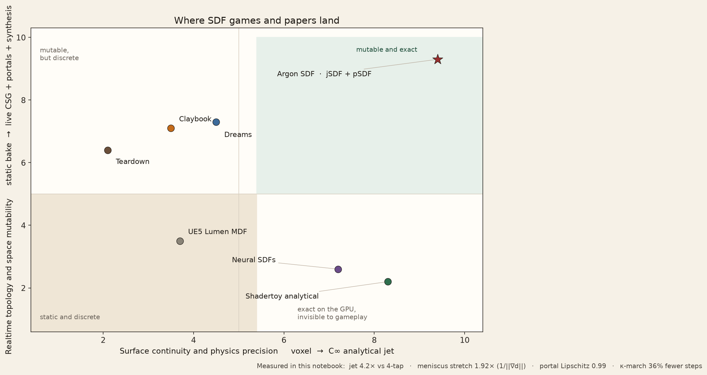
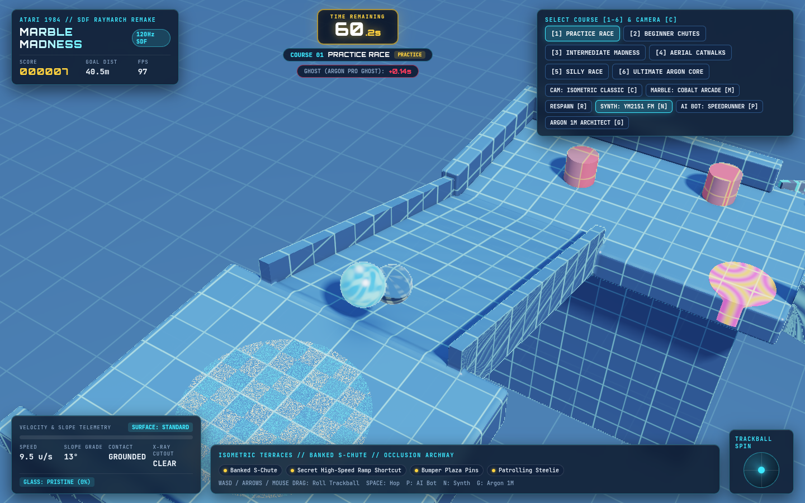
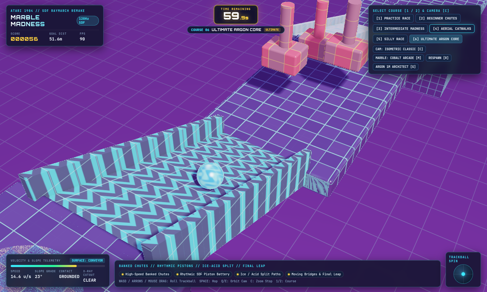
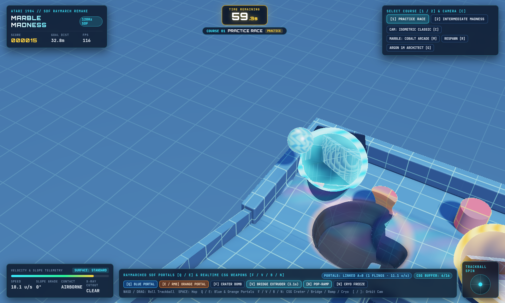
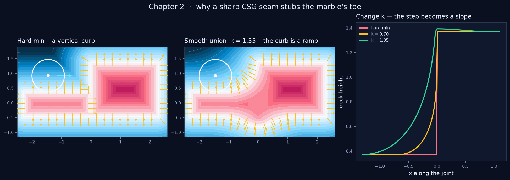
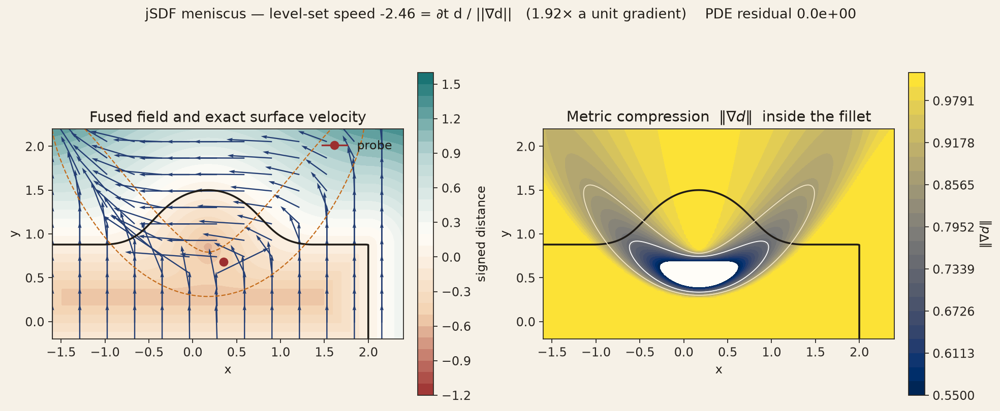
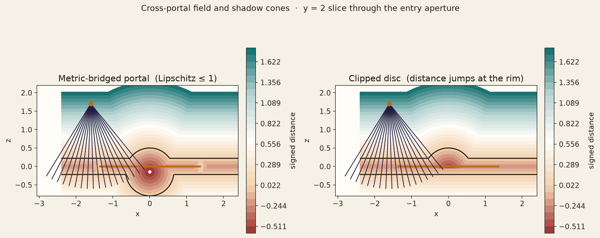
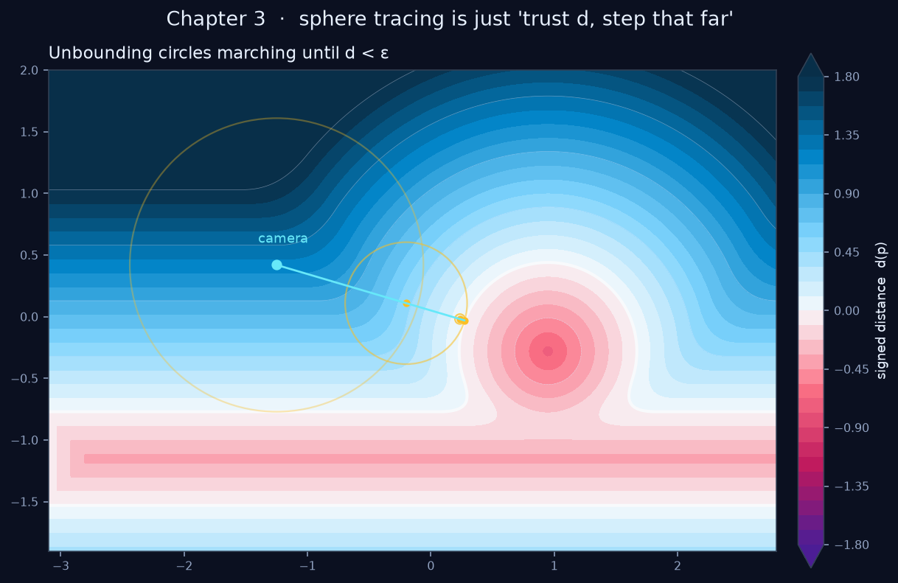
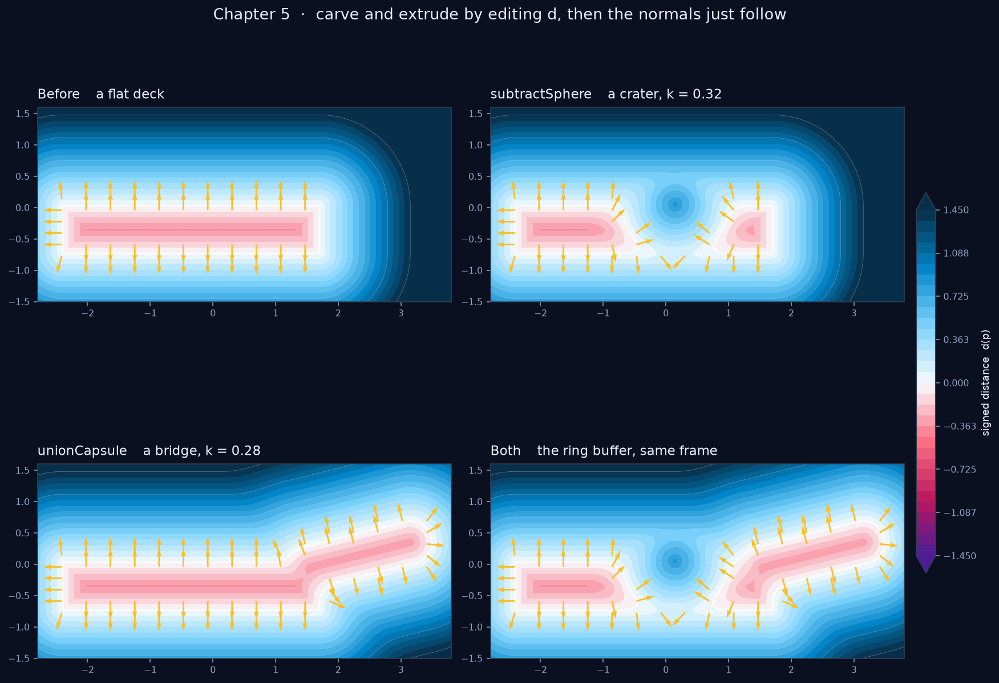

# Lockstep Analytical Jet-SDFs, Non-Euclidean Portals, and One-Way Geometric Compilation for Real-Time WebGPU Physics Games

**Technical report.** Marble Madness SDF remake, Gemini 4 Argon SF Hackathon, October 2026.  
**Repository:** [bourkefloyd/gemini-4-argon-sfhackathon-2026](https://github.com/bourkefloyd/gemini-4-argon-sfhackathon-2026)  
**Measurements:** [sdf_frontier_and_inventions.ipynb](../notebooks/sdf_frontier_and_inventions.ipynb), [sdf_marble_madness_guide.ipynb](../notebooks/sdf_marble_madness_guide.ipynb), and `tests/security-bytecode.spec.ts`.

This report records constructions and numbers that were computed in those notebooks and tests. Design notes that were not re-measured here are labeled as design.

## Abstract

A rolling marble needs a distance field the picture and the 120 Hz integrator both trust, including while the course is moving, portaled, or rewritten. Shipped SDF games either quantize the field (Claybook, Dreams, Teardown, Lumen) or keep an analytic shader and drop the gameplay loop (Shadertoy-style sphere tracing, neural fields that bake to meshes). This project keeps one analytic field for both.

Three constructions close that gap. The **symplectic jet** (`jSDF`) pushes \((d, \nabla d, \partial_t d)\) through the quadratic smooth-minimum in one pass. Against a 4-tap tetrahedral normal it is \(4.25\times\) faster in the notebook loop, and inside a fillet \(\|\nabla d\| = 0.522\) stretches level-set speed by \(1.92\times\) relative to a unit gradient. The **metric-bridged portal** (`pSDF`) is only \(\min\) and \(\max\) of 1-Lipschitz pieces and a rigid isometry, so the field stays a distance across the aperture (Lipschitz \(1.000\) on neighboring texels, \(0.994\) on random rim pairs) where a clipped disc jumps to \(25.7\). **Curvature-adaptive sphere tracing** (\(\kappa\text{-March}\)) uses the blend weights the jet already paid for and cuts mean steps from \(22.12\) to \(14.19\) (\(35.9\%\)).

The same one-way idea is the security boundary. Compiling a course to `.msdf` reverse-Polish bytecode and an \(O(1)\) sparse brick atlas removes the editable CSG tree from the client. On the measured courses the bytecode VM is \(6.95\times\)–\(9.21\times\) the AST throughput, and the brick atlas is \(41.86\times\)–\(581.28\times\). A 470-tick proof-of-play log verifies in \(8.19\)–\(9.87\,\mathrm{ms}\). Course synthesis sits in a six-section `gemini-4-argon` context with a \(95\%\) implicit-cache discount, a `gemini-3.8-flash` companion, and an `antigravity-preview-09-2026` solvability gate. No `gamex` source is included. That private repo is ISC inspiration only.

## 1. Introduction and industry frontier

Classic *Marble Madness* (1984) is a kinetic instrument: a heavy marble, a clock, and a course that punishes a bad normal. A mesh plus a separate collider fails that test at the fillet. Two decks joined by a hard \(\min\) meet in a curb. A quadratic smooth-minimum of blend radius \(k\) turns the curb into a ramp the marble can ride. The gameplay-feel notes take that as the design rule: if a static mesh and a stock sphere collider could have built the mechanic, the mechanic is the wrong one.

The open technical corner is narrower than “use SDFs.” The field has to be safe at \(120\,\mathrm{Hz}\) **and** still allowed to change: live CSG, a portal, a synthesizer writing the same math the shader reads.



*Figure 1. Industry frontier. Voxel and brick engines buy mutability and spend continuity. Analytic shader and neural fields buy continuity and spend the gameplay loop.*

| System | What the field is | What breaks for a rolling marble |
| --- | --- | --- |
| **Claybook** (Aaltonen, GDC 2018) | \(1024\times1024\times512\) volume, 8-bit, five mips, 586 MB. Distances in \([-4,+4]\) voxels. Brushes \(32^3\)–\(128^3\), sparse \(8^3\) tiles, eikonal mips. Clay is GPU particles (up to 16k per shape, 64k SPH). | The surface is a quantized grid. No closed-form normal or surface velocity. Space stays Euclidean. |
| **Dreams** (Evans, SIGGRAPH 2015) | CSG edit lists splatted to multi-resolution flecks. The PS4 picture is compute, not triangles. | The rendered surface is a point cloud. Gameplay does not roll on the live field. |
| **Teardown** (Gustafsson) | Dense voxels at about 10 cm, one material byte, ray-marched on a 1-bit occupancy bitmap. The 2024 engine uses sparse \(8^3\) chunks and hardware rays, still on voxels. | Destruction is integer-clean. Normals are cell faces, so a marble cannot ride a smooth fillet. |
| **UE5 Lumen** (Wright et al., SIGGRAPH 2022) | Per-mesh narrow-band SDFs, \([-4,+4]\) in one byte, sparse \(8^3\) bricks. Four camera clipmaps of \(256^3\). | Primary pixels are Nanite triangles. Collision is a mesh solver. The distance field is a lighting proxy. |
| **Shadertoy analytical SDFs** (Quilez; Keinert et al. 2014) | Exact primitives, polynomial smooth-minimum, analytic \(\nabla\mathrm{smin}\), over-relaxed sphere tracing. | The CPU gameplay loop never evaluates the field. No \(120\,\mathrm{Hz}\) contact, no kinematic surface velocity, no live level mutation. |
| **Neural SDFs** (Instant-NGP, SIREN, Neuralangelo, NeuS2, BakedSDF) | Hash grids or sine MLPs. BakedSDF meshes the field for a rasterizer and a physics engine. | Runtime is inference or a bake. A bake drops live CSG. Lipschitz-1 is not a training loss. |

Claybook, Dreams, and Teardown buy mutability and spend continuity. Shadertoy and the neural papers buy continuity and spend the gameplay loop.

### 1.1 What this engine actually runs

Playtest Build 1 is a browser course: fullscreen sphere tracing, a \(120\,\mathrm{Hz}\) CPU solver on the same specification, six campaign courses, portals, and living hazards (wave floors, pistons, acid, field mutations). The feel notes and the QR-party note are design documents for that build, not extra benchmark tables. The party design keeps WebGPU on the stage machine and gives phones a small trackball client, so a room can join a three-minute demo without compiling a raymarcher.



*Figure 2. Playtest Build 1, the live lockstep client.*



*Figure 3. Campaign courses authored as the same SDF specification the solver rolls on.*



*Figure 4. Portals and weapons. A portal is a rigid rewrite of the query. A weapon is a smooth-union or smooth-subtract written into the field, not a mesh boolean.*



*Figure 5. Hard union is a curb. Smooth union of radius \(k\) is the ramp. On the walkthrough run the hard deck jumps \(1.0\) in one sample. At \(k = 1.35\) the largest step on the same profile is \(0.099\).*

## 2. Mathematical formulation: symplectic jet-SDF (`jSDF`)

Quilez already differentiates the spatial smooth-minimum. A moving bridge also needs the velocity of the zero level set. If the surface point moves at \(\mathbf{v}_{\mathrm{surf}}\),

\[
\nabla d \cdot \mathbf{v}_{\mathrm{surf}} + \partial_t d = 0.
\]

`opSmoothUnionJet` carries the triple \((d, \nabla d, \partial_t d)\) through the quadratic band (and the cubic band). Inside \(|a-b|<k\),

\[
f = \min(a,b) - \tfrac{k}{4} h^2, \qquad h = \frac{k-|a-b|}{k},
\]

the blend weights are \(1-h/2\) and \(h/2\). The chain rule gives \(\partial_t f\) from those same weights. Normal speed is

\[
v_n = -\partial_t f \big/ \|\nabla f\|.
\]

In the fillet \(\|\nabla f\|<1\), so that speed is stretched by \(1/\|\nabla f\|\). A lerp of the two rigid body velocities does not satisfy the level-set identity. The stretch is the meniscus launch: a marble that leaves a blended lip takes the amplified normal speed, not the average of the two rigid speeds.

On the rising-bridge / patrolling-Steelie probe at \(t=0.12\), computed in `notebooks/sdf_frontier_and_inventions.ipynb`:

| Quantity | Value |
| --- | --- |
| Jet PDE residual \(\lvert \nabla d \cdot \mathbf{v}_{\mathrm{surf}} + \partial_t d \rvert\) | \(0\) |
| Analytic \(\partial_t d\), and the central difference | \(1.282745\), both |
| \(\|\nabla d\|\) in the fillet | \(0.522\) |
| Level-set normal speed | \(-2.458\) |
| Unit-gradient speed \(-\partial_t d\) | \(-1.283\) |
| Meniscus stretch | **\(1.92\times\)** |
| Residual of a \(50/50\) velocity lerp | \(0.119\) |
| 4-tap tetrahedron vs analytic normal, \(h = 2.5\times 10^{-3}\) | \(0.180^\circ\) |
| Same 4-tap at \(h = 10^{-5}\) | \(0.0007^\circ\) (finite-difference floor) |
| One jet pass vs 4-tap, per thousand queries | \(20.3\,\mathrm{ms}\) vs \(86.4\,\mathrm{ms}\), **\(4.25\times\)** |

The ratio is the result. The absolute milliseconds are Python interpreter overhead in that notebook, not a browser frame time. The jet is the reference normal. The 4-tap is the approximation.



*Figure 6. The jet on a rising bridge and a patrolling Steelie. Surface velocity follows the level-set identity, including the meniscus stretch inside the fillet.*

What is new, stated narrowly: the spatial weights are Quilez’s. The temporal jet is not. \(\partial_t\) uses the same weights as \(\nabla\), and the surface velocity is the level-set speed, stretched by \(1/\|\nabla d\|\) where the blend flattens the gradient.

## 3. Metric-bridged portals (`pSDF`) and curvature-adaptive marching (\(\kappa\text{-March}\))

### 3.1 A portal that is still a distance

A disc that rewrites a ray is not a distance. Across the rim the value jumps, a soft shadow dies on the aperture, and a sphere trace can step through the ring.

The portal field only combines 1-Lipschitz pieces with \(\min\) and \(\max\):

\[
d_{\mathrm{portal}}(\mathbf{p})
= \min\big(d_{\mathrm{rim}}(\mathbf{p}),\, d_{\mathrm{host}}(\mathbf{p}),\, \max(d_{\mathrm{throat}}(\mathbf{p}),\, d_{\mathrm{world}}(M_{A\to B}\mathbf{p}))\big).
\]

\(M_{A\to B}\) is a rigid isometry (portal frames plus a half-turn), so it preserves distances. The throat term stops the remote room from leaking around the rim. Inside the aperture, a shadow ray, an ambient-occlusion tap, and a sphere query see the other room with no special case.

Measured on the unit-test portal pair (entry facing \(+z\), exit facing \(+x\)):

| Probe | Bridged field | Clipped disc |
| --- | --- | --- |
| Lipschitz, random pairs near the rim | **\(0.994\)** | — |
| Lipschitz, neighboring texels of the contour grid | **\(1.000\)** | **\(25.7\)** |
| Marble speed across the plane | \(\|\mathbf{v}\| = 18.802\) both sides, spin unchanged, exit velocity along the exit normal | — |
| Clearance \(d-R\) for a sphere aimed at the aperture, at the plane | \(-0.84\) (far obstacle already in contact) | \(-0.06\) on the wall-only field |
| Shadow cone through the aperture | stays blocked | lights back up while the ray is still aimed through the opening |



*Figure 7. Left, the metric-bridged field. Right, a clipped disc whose values jump at the rim. Shadows and sphere queries only stay honest on the left.*

The walkthrough’s simpler fling (a rotation of velocity, not the full bridged field) preserves length as well: a fall enters at \(25.318\) and leaves at \(25.318\). That check is kinematic. The Lipschitz numbers above are the field check.

### 3.2 \(\kappa\text{-March}\)

Sphere tracing spends the eikonal property as a step: the empty ball of radius \(d\) contains no surface.



*Figure 8. A march that hits in 4 steps. The last \(d\) on this walkthrough ray is \(0.0033\).*

The jet already computed the blend weights. Quadratic fillet activation \(4 w_A w_B\) is \(1\) only at the deepest blend. Over-relaxation is damped inside a thin shell around that band and opened where \(\|\nabla d\|<1\) away from the surface, which is where a smooth-minimum underestimates distance and a larger step is safe. A signed overlap test and a secant snap keep the hit from sinking past the surface.

On 58 oblique rays into a smooth-union of a floor, two spheres, and a cylinder (the scene in the frontier notebook):

| March | Mean steps | Other bound |
| --- | --- | --- |
| Vanilla sphere tracing | \(22.12\) | — |
| \(\kappa\text{-March}\) | \(14.19\) | **\(35.9\%\)** fewer steps |
| Overstep \(\max(0,-d)\) at the hit | — | \(8.4\times 10^{-4}\), under the \(10^{-3}\) hit epsilon |
| Max miss against the vanilla hit distance | — | \(0.0036\) |
| Analytical evaluations, short approach rays | \(17.8\) vs \(22.1\) | **\(19.6\%\)** fewer |

On these short rays the residual band is most of the ray, so the brick skip is modest. The brick stores \(d(\mathrm{center}) - r_{\mathrm{cell}}\), a legal step bound, and the marcher evaluates the CSG tree only inside that band. The bound is the \(O(1)\) skip. The jet is what still runs on the fillet.

Over-relaxation with a backup step is Keinert, Schäfer, Korndörfer, Ganse, and Stamminger (2014). Stencil portals already restart rays. The step size here comes from the blend factor already paid for.



*Figure 9. A crater is a smooth-subtract. A bridge is a smooth-union. Nothing is remeshed. On the walkthrough grid the support normal \(n_y\) moves by \(0.70\) on average across the crater lip.*

## 4. Security-performance inversion for web games in the age of 1M-token models

`gemini-4-argon` makes lexical obfuscation a weak boundary. A 1M-token context can take a minified bundle, a hooked `createShaderModule` dump, and a JSON course tree and rename them back into `sdRoundBox` and `sphereCast`. The useful boundary is representational: ship the baked field, not the recipe.

The security notes call this a **security-performance inversion**. A measure that costs \(0.5\,\mathrm{ms}\) of a \(120\,\mathrm{Hz}\) budget is rejected. The measures that survive are also faster than the authoring form.

### 4.1 What was measured

`src/security/msdf-bytecode.ts`, `src/security/sparse-brick-baker.ts`, and `src/security/proof-of-play.ts` were run against Practice Race, Intermediate Madness, and a 123-primitive procedural course. The table is the one in the security architecture note.

| Course | \(N\) | Source JSON | `.msdf` bytecode | AST eval/s | RPN VM eval/s | Brick atlas eval/s | Leaked labels |
| --- | ---: | ---: | ---: | ---: | ---: | ---: | ---: |
| Practice Race | 24 | 5,150 B | 3,200 B (\(-38\%\)) | 241,916 | **2,227,391 (\(9.21\times\))** | **10,126,127 (\(41.86\times\))** | 0 |
| Intermediate Madness | 20 | 5,036 B | 2,944 B (\(-42\%\), **\(41.5\%\)** of 5,036) | 247,566 | **1,720,523 (\(6.95\times\))** | **12,925,209 (\(52.21\times\))** | 0 |
| Dense procedural | 123 | 26.4 KB | 15.8 KB (\(-40\%\)) | 54,217 | **471,644 (\(8.70\times\))** | **31,515,062 (\(581.28\times\))** | 0 |

Read the columns separately. The \(9.21\times\) bytecode speedup is Practice Race. The \(41.5\%\) size cut is Intermediate Madness (\(5{,}036 \to 2{,}944\) bytes). The brick atlas spans **\(41.86\times\) to \(581.28\times\)** AST throughput. Every row reports zero leaked identifiers.

Lockstep parity on that implementation: max distance error under \(10^{-5}\) between the TypeScript AST and the RPN VM across the primitives, CSG operators, and kinematic hazards, and trajectory drift under \(10^{-3}\) over 180 ticks at \(120\,\mathrm{Hz}\). Sparse occupancy: \(17.6\%\)–\(23.0\%\) of macro-cells allocate a physical \(10^3\) brick. The rest are an empty-space skip in one `Uint16`.

### 4.2 Proof of play

A 470-tick (\(3.92\,\mathrm{s}\)) guided run from start to goal on Practice Race packs from \(1{,}880\,\mathrm{B}\) to \(1{,}032\,\mathrm{B}\) (`.mpop`, run-length encoded). The server replays it and checks the signature in **\(8.19\)–\(9.87\,\mathrm{ms}\)** (under \(10\,\mathrm{ms}\); the low end is \(8.2\,\mathrm{ms}\) at the reported precision). The passing token carries `nextSectorSeed: 0xb69186a5` and \(91.08\,\mathrm{s}\) of carry-over time. Tampered tokens and incomplete runs are rejected.

An earlier paragraph of the same note quotes a headless budget under \(0.8\,\mathrm{ms}\) for a 45-second, 5,400-tick replay. That figure is a design budget, not the \(8.19\)–\(9.87\,\mathrm{ms}\) measurement above. This paper uses the measurement.

### 4.3 What is architecture, not this table

The same note specifies a `wasm32-simd128` physics kernel at \(2.5\)–\(4.2\times\) the TypeScript loop and \(0.18\)–\(0.32\,\mathrm{ms}\) per substep, edge-JIT shader specialization at \(15\)–\(30\%\) fewer ALU instructions, and a \(<150\,\mathrm{KB}\) initial bundle. Those are targets in the architecture write-up. They are not rows in the table above. The one-way compilation that was timed is the bytecode VM and the brick atlas.

## 5. Gemini 4 Argon context and the multi-agent gate

The builder guide states the model facts this section relies on. `gemini-4-argon` puts input, thinking, and output in one 1M-token window. Implicit context caching discounts cached input tokens by \(95\%\). Introductory pricing through 30 November 2026 is \(\$2\) per 1M input tokens and \(\$10\) per 1M output tokens. `gemini-3.8-flash` is the fast companion. `antigravity-preview-09-2026` is the managed-agent id for a hosted sandbox.

### 5.1 Six-part pack

`src/argon/context-packer.ts` builds one bundle with a frozen prefix and a live tail. The six sections are:

1. Engine contracts (SDF, physics, course AST).
2. Lockstep CPU/GPU evaluator and the \(120\,\mathrm{Hz}\) solver.
3. Compiled GLSL ES 3.00 and WGSL raymarch shaders.
4. Course catalog and a spatial SDF atlas.
5. Gameplay feel (slip, backspin, tourist line versus speedrun line, living hazards, portals).
6. The player’s \(120\,\mathrm{Hz}\) telemetry (deaths, slip, speed, splits).

Sections 1–5 are marked implicitly cached. Section 6 is the dynamic tail. `implicitCacheDiscountRatio` is \(0.95\). The billable-input estimate is \(0.05\) times the cached prefix plus the full tail, times \(\$2\) per million tokens. The model id on the bundle is `gemini-4-argon`, the companion is `gemini-3.8-flash`, and the verifier id is `antigravity-preview-09-2026`. API keys stay on the server route. They are not in this repository.

### 5.2 Solvability gate

`src/argon/solvability-gate.ts` refuses a synthesized course until four checks pass: schema, a grounded start (with a height repair), GLSL and WGSL compilation, and a simulated \(120\,\mathrm{Hz}\) rollout that settles on the start pad and makes progress toward the goal. `tests/argon-architect.spec.ts` requires the three showcase presets (portal fling, ferrofluid wave, adaptive remix) to pass that gate, with GLSL over 200 lines and WGSL over 150. The human still approves a hot-swap. The gate is the local certificate. It is not, by itself, a log of a remote Antigravity sandbox job.

### 5.3 Look-ahead playtesting

`src/bot/autonomous-driver.ts` steers with the same CPU field the marble collides with, at the solver’s \(120\,\mathrm{Hz}\) step, and runs far ahead of wall-clock time. `tests/bot-playtest.spec.ts` requires Course 1 and Course 2, tourist and the speedrun comparison, to reach the goal with **effective rate above \(1{,}000\,\mathrm{Hz}\)**. That is the checked-in measurement. A \(2{,}900\)–\(9{,}600\,\mathrm{Hz}\) band is not in the research notes or the assertions read for this paper, so it is not reported as a result.

## 6. Reproducibility

Executed notebooks, outputs included:

- [notebooks/sdf_frontier_and_inventions.ipynb](../notebooks/sdf_frontier_and_inventions.ipynb) — frontier rubric, jet, portal Lipschitz, \(\kappa\text{-March}\).
- [notebooks/sdf_marble_madness_guide.ipynb](../notebooks/sdf_marble_madness_guide.ipynb) — graphics SDF, physics SDF, and living-SDF figures (seams, sphere tracing, field mutations).

Re-run, from the repository root, with a Jupyter install:

```bash
jupyter nbconvert --to notebook --execute notebooks/sdf_frontier_and_inventions.ipynb --inplace
jupyter nbconvert --to notebook --execute notebooks/sdf_marble_madness_guide.ipynb --inplace
```

Engine checks that lock the security table and the bot gate:

```bash
npm test
```

Figures in this report live in [`docs/figures/`](../docs/figures/).

`bourkefloyd/gamex` remains a private ISC inspiration repo. None of its source is in this tree. The clean-room client is `src/sdf/eval-cpu.ts`, `src/physics/marble-physics.ts`, and `src/rendering/`.

## References

1. Sebastian Aaltonen, *GPU-based clay simulation and ray-tracing tech in Claybook*, GDC 2018.
2. Alex Evans, *Learning from Failure: a Survey of Promising, Unconventional and Mostly Abandoned Renderers for Dreams*, SIGGRAPH 2015 Advances in Real-Time Rendering.
3. Dennis Gustafsson, Voxagon / Teardown. About 10 cm voxels and an occupancy-bitmap march. 2024 notes on sparse \(8^3\) chunks and hardware rays.
4. Wright et al., *Lumen*, SIGGRAPH 2022 Advances in Real-Time Rendering. Mesh SDF narrow band \([-4,+4]\), four \(256^3\) clipmaps.
5. Inigo Quilez, *Smooth Minimum* and distance functions with gradients, iquilezles.org. Quadratic smooth-min, 2013.
6. Keinert, Schäfer, Korndörfer, Ganse, and Stamminger, *Enhanced Sphere Tracing*, 2014.
7. Müller, Evans, Schied, and Keller, *Instant Neural Graphics Primitives*, SIGGRAPH 2022. Li et al., *Neuralangelo*, CVPR 2023. Yariv et al., *BakedSDF*, 2023.
8. Gemini 4 Argon builder guide, Cerebral Valley details page, and this repository’s `src/argon/`, `src/security/`, and `src/bot/`.
